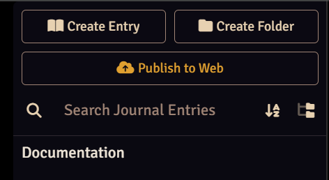

# World2Web

**Publish your Foundry VTT journals to a website**, so your players can read lore, quest notes and
session recaps any time, even when your Foundry server is offline.

- **You choose what goes public.** Nothing is published until you mark a journal as publishable
  and publish its pages one at a time.
- **Players can post too.** Session notes appear under each player's character name and portrait.
- **One click to update.** Write in Foundry, click **Publish to Web**, and your site updates a few
  minutes later.
- **Free to run, and yours.** Your content lives in your own GitHub repository and is served by a
  free hosting provider (Cloudflare, Netlify or Vercel). No World2Web server ever sees it.

**See it live:** the [World2Web documentation site](https://world2web.loodingdongs.com) is itself
a Foundry journal, published with World2Web's default settings.



## Requirements

- Foundry VTT v13 or v14
- A free [GitHub](https://github.com/) account
- A free account at [Cloudflare](https://www.cloudflare.com/), [Netlify](https://www.netlify.com/)
  or [Vercel](https://vercel.com/) (or any host that serves plain HTML)

## Install

In Foundry's setup screen, go to **Add-on Modules → Install Module**, paste this manifest URL, and
click **Install**:

```
https://github.com/gludington/world2web/releases/latest/download/module.json
```

Then enable **World2Web** in your world under **Game Settings → Manage Modules**.

## Getting started

The full illustrated guide ships inside Foundry as the **World2Web Documentation** compendium, and
is also online at [world2web.loodingdongs.com](https://world2web.loodingdongs.com). In short:

1. **Set up your site** (about 10 minutes, once). In **Configure Settings → World2Web**, click
   **Setup Wizard**. It walks you through creating your site at your chosen host, creating a
   GitHub token, and connecting Foundry to it. It checks the connection before saving.
2. **Choose a journal.** Click the new gear icon in any journal's header and check **Publish this
   journal to the web**. You can also set its author, tags and where it appears on the site.
3. **Publish pages.** Click a page's publish control in the journal's page list.
4. **Click Publish to Web** at the top of the Journals sidebar. Your site rebuilds with the new
   posts a few minutes later.

### Letting players publish

Turn on **Allow Player Self-Publish** in the module settings. Players can then publish journals
they own, and their posts appear under their character's name and portrait.

## What your site includes

A chronological list of posts on the homepage, a page per journal, per-author and per-tag archives,
sections that follow your Foundry folder structure, full-text search, links between posts (Foundry
`@UUID` links become real links), and a choice of built-in themes.

## Customizing your site (advanced)

Most people never need this. Site name, theme and URL layout are all module settings in Foundry.

For full control, your site is an ordinary [Astro](https://astro.build/) project in your own
GitHub repository, generated from
[world2web-site-template](https://github.com/gludington/world2web-site-template). You can:

- **Edit your own site's repository directly**: layout, pages and styles. World2Web only ever
  writes to `content/` (your posts) and `public/assets/` (their images), so your changes
  elsewhere are never overwritten by a publish. Start with
  the template's README, and with `src/styles/README.md` for theming.
- **Make your own template.** Copy world2web-site-template, customize it, and use it for every
  campaign site you create.
- **Preview locally before publishing.** Turn on **Enable Dev Mode** in the module settings to get
  a **Dev Sync** button. It downloads what would be published as a JSON file, which the template's
  `scripts/ingest.js` turns into content for `npm run dev`. No GitHub involved.

You need some familiarity with Git, Node.js and Astro for any of these.

## Security note

The GitHub token is stored in your world's settings. Create it as the Setup Wizard suggests (a
fine-grained token with access to **only your site's repository** and **Contents: Read and
write**), so the most anyone could ever do with it is change that one site. Don't reuse a broader
token here.

## Support

Found a bug or have a question? [Open an issue](https://github.com/gludington/world2web/issues).

Contributors: see [DEVELOPMENT.md](DEVELOPMENT.md) for architecture, the data format and tests.
